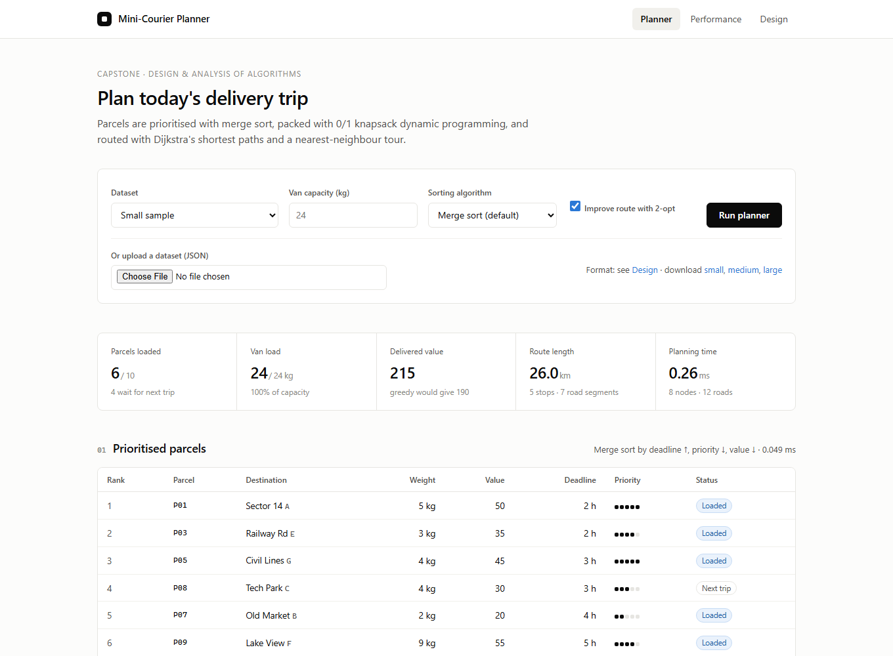
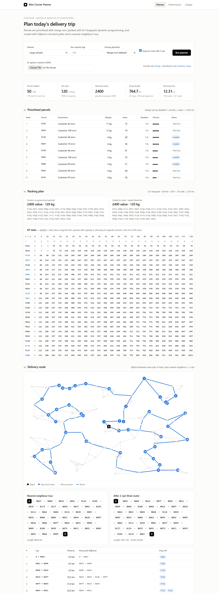
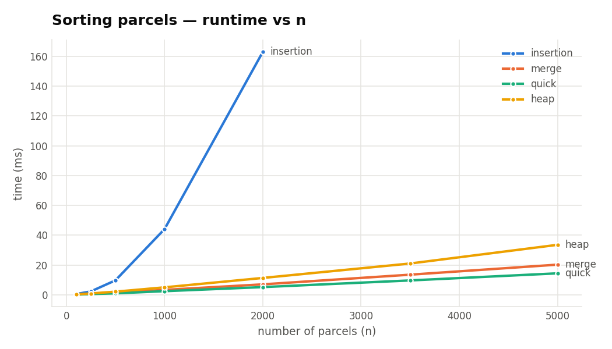
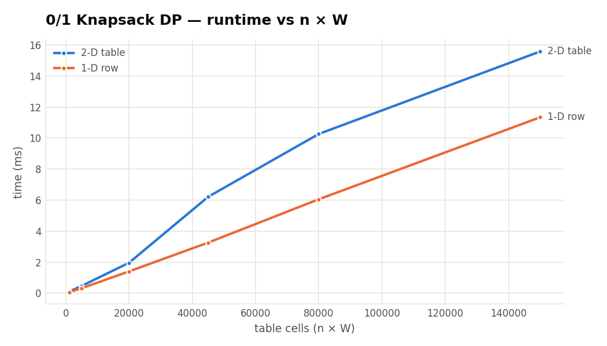
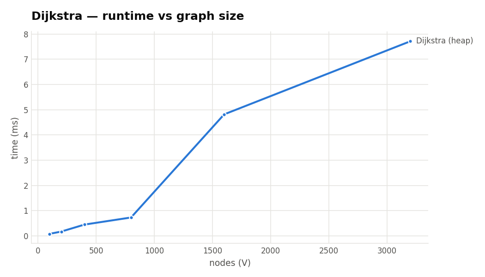
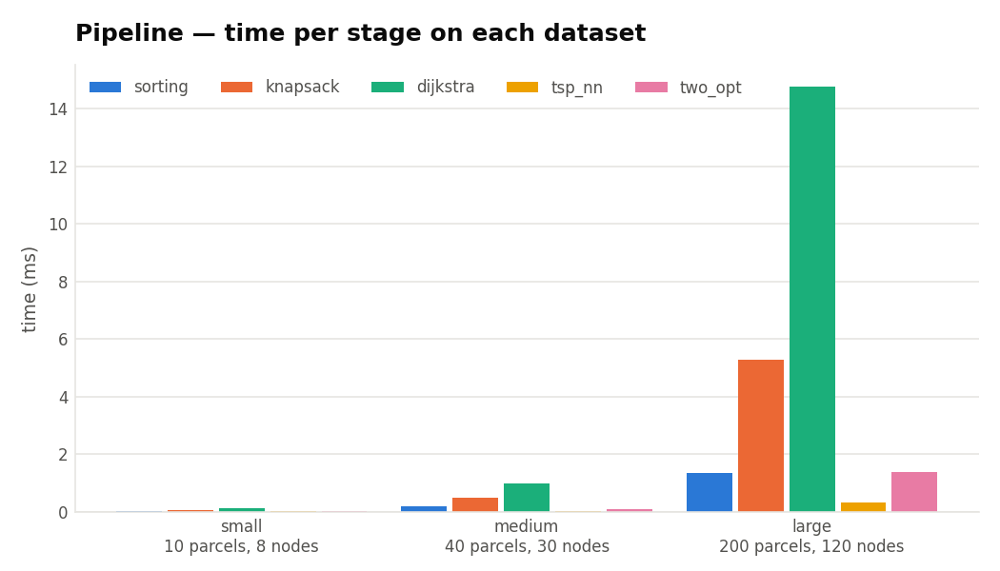
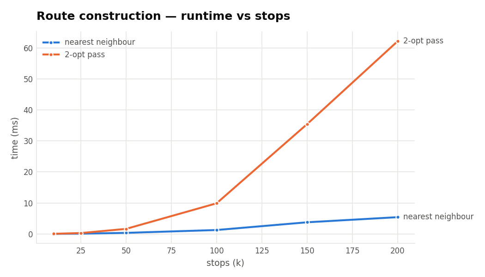
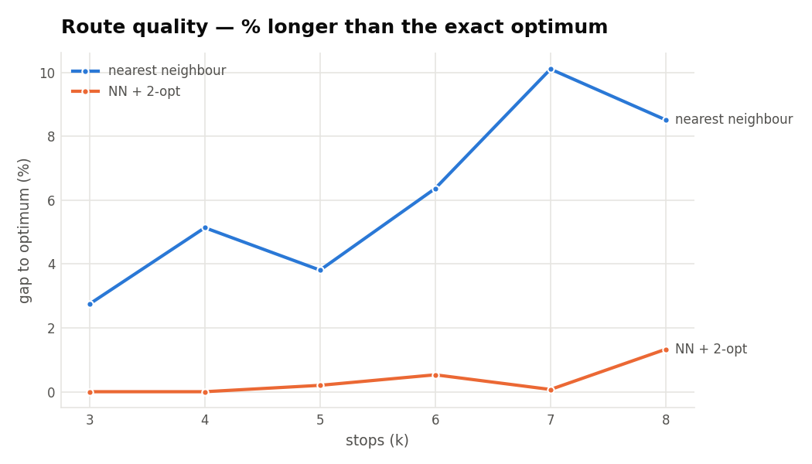

# Mini-Courier Planner

**Design & Analysis of Algorithms (ETCCDA302) — Capstone Assignment**

A prototype courier-planning system. Given a list of parcels and a road network of delivery
points, it produces an **optimised packing plan** for one van trip and an **ordered delivery route**.
It combines four algorithm families from the lab assignments:

| Stage | Algorithm | File |
|---|---|---|
| Prioritise parcels | Merge sort (vs. insertion, quick, heap sort) | [courier/sorting.py](courier/sorting.py) |
| Fill the van | 0/1 knapsack — dynamic programming | [courier/knapsack.py](courier/knapsack.py) |
| Shortest road paths | Dijkstra with a binary heap | [courier/graph.py](courier/graph.py) |
| Visiting order | Nearest-neighbour TSP approximation + 2-opt | [courier/tsp.py](courier/tsp.py) |



---

## Quick start

```bash
git clone https://github.com/Krishyangi-bit/DAA_Capstone.git
cd DAA_Capstone
pip install -r requirements.txt          # flask, matplotlib

python app.py                            # website  -> http://127.0.0.1:5000
python main.py                           # command line, small dataset
python -m unittest discover tests -v     # correctness tests
python benchmark.py                      # runtime experiments + charts (~20 s)
```

Python 3.9+ is required. The algorithms themselves use only the standard library.

### Command-line options

```bash
python main.py data/large.json                          # any dataset file
python main.py data/medium.json --capacity 40           # override van capacity
python main.py data/small.json --sort quick --no-2opt   # change sort / plain NN route
python main.py data/small.json --show-table             # print the full DP table
python data/generate.py --nodes 80 --parcels 120 --capacity 60 --out data/custom.json
```

### Website

| Page | What it shows |
|---|---|
| **Planner** `/` | Choose a sample or upload a JSON dataset, set capacity / sort / 2-opt, and see the sorted parcels, DP table, DP-vs-greedy comparison, route map, road-level legs and stage timings. Shareable links work too: `/?dataset=large&sort=quick&capacity=80` |
| **Performance** `/performance` | Benchmark charts and tables from `results/benchmark.json` |
| **Design** `/design` | Data model, algorithm choices and route logic |
| **API** `/api/plan?dataset=small` | JSON result (or `POST` a dataset) |

---

## Project structure

```
courier/
  models.py      Parcel / Node / Dataset, JSON loading and validation
  sorting.py     insertion, merge, quick, heap sort + prioritise()
  knapsack.py    0/1 knapsack DP (2-D with traceback, 1-D), greedy baseline
  graph.py       adjacency-list graph, Dijkstra, path reconstruction, distance matrix
  tsp.py         nearest neighbour, 2-opt, brute force (for checking), route expansion
  planner.py     the integrated, timed pipeline
data/            small.json, medium.json, large.json, generate.py
tests/           unit tests against brute-force references
templates/, static/   website (Flask + plain HTML/CSS, no JS framework)
docs/
  design.md      Phase 1 design document
  charts/        runtime charts (Phase 4)
  screenshots/   website screenshots (Phase 5)
  traces/        CLI output traces and test log (Phase 5)
results/         benchmark.json
main.py          CLI      app.py   website      benchmark.py   Phase 4 experiments
```

---

## Phase 1 — Design

Full document: **[docs/design.md](docs/design.md)**.

- **Parcel**: `id, destination, weight (kg, int), value, deadline (h), priority (1–5)`
- **Graph**: nodes `id, name, x, y`; undirected weighted edges `from, to, distance`; stored as an adjacency list.
- **Pipeline**: sort → knapsack → Dijkstra from depot and each stop (metric closure) → nearest neighbour → 2-opt → expand legs into road paths.

## Phase 2 — Prioritisation and box filling

Parcels are sorted by **(deadline ↑, priority ↓, value ↓)** with merge sort — stable and O(n log n) in
every case. The sorted list is then packed with the 0/1 knapsack DP:

```
dp[i][w] = max( dp[i-1][w],  dp[i-1][w - weight_i] + value_i )     O(n·W) time and space
```

Selected parcels are recovered by tracing back through the table. On the small dataset
(capacity 24 kg) the DP loads **P01, P03, P05, P07, P09, P10 → value 215, 24/24 kg**, while the greedy
value/weight rule only reaches **190** — a concrete case where greedy is not optimal for 0/1 knapsack.
Full DP table: [docs/traces/small.txt](docs/traces/small.txt).

## Phase 3 — Route maker

Dijkstra runs from the depot and from every stop to build a shortest-path distance matrix plus the
real road paths. Nearest neighbour builds the tour, 2-opt removes crossings, and each leg is expanded
back into road segments.

Small dataset result:

```
Route : D -> A -> B -> E -> F -> G -> D      26.0 km
Legs  : D>A 4.0 | A>B 3.0 | B>C>E 8.0 | E>F 3.0 | F>G 4.0 | G>D 4.0
```

On the large dataset (42 stops) nearest neighbour gives 966.8 km and **2-opt shortens it to 764.7 km (−20.9%)**.



## Phase 4 — Performance testing

`python benchmark.py` times each component at growing input sizes (median of 3 runs) and writes
[results/benchmark.json](results/benchmark.json) and the charts below. Correctness is checked by
16 unit tests ([tests/test_algorithms.py](tests/test_algorithms.py), log in
[docs/traces/tests.txt](docs/traces/tests.txt)): sorts against `sorted()`, knapsack against brute
force over all subsets, Dijkstra against Bellman-Ford, and the TSP heuristics against the exact optimum.

| Sorting | Knapsack |
|---|---|
|  |  |
| **Dijkstra** | **Pipeline stages** |
|  |  |
| **TSP runtime** | **TSP quality vs optimum** |
|  |  |

**Results** (on the machine used for the benchmark — your numbers will differ):

| Stage (ms) | small (10 parcels, 8 nodes) | medium (40, 30) | large (200, 120) |
|---|---:|---:|---:|
| Merge sort | 0.04 | 0.19 | 1.36 |
| Knapsack DP | 0.08 | 0.50 | 5.28 |
| Dijkstra (all stops) | 0.12 | 1.00 | 14.77 |
| Nearest neighbour | 0.02 | 0.04 | 0.34 |
| 2-opt | 0.01 | 0.08 | 1.37 |
| **Total** | **0.27** | **1.83** | **22.96** |

**Observations**

- **Sorting** — insertion sort takes 163 ms at n = 2000 while merge sort takes 7 ms: O(n²) vs O(n log n).
  Quick sort is a little faster than merge sort in practice, heap sort is the slowest of the three
  (poor cache behaviour), but merge sort is kept for stability and its guaranteed bound.
- **Knapsack** — runtime tracks the n × W cell count (pseudo-polynomial). The 1-D version is ~30–45%
  faster and uses O(W) memory, but cannot recover which parcels were chosen.
- **Dijkstra** — grows almost linearly on sparse road graphs (E ≈ 2V). It is the most expensive stage
  of the pipeline because it runs once per stop.
- **TSP** — nearest neighbour averages 3–10% above the true optimum for 3–8 stops; with 2-opt the gap
  drops to under 1.5%. On 100–200 random stops 2-opt shortens NN tours by 10–19%.

**Future optimisation**

1. Cache the depot/stop distance matrix between runs, or use A* with straight-line distance, to cut Dijkstra cost.
2. Scale weights to coarser units (e.g. 0.5 kg) for large vans to shrink W in the DP table.
3. Use Or-opt or Christofides for better routes; split parcels across several trips (multi-knapsack / VRP).
4. Use Python's built-in Timsort (C implementation) in production; the hand-written sorts are for analysis.

## Phase 5 — Demonstration

- Screenshots: [planner (small)](docs/screenshots/planner-small.png), [planner (large)](docs/screenshots/planner-large.png),
  [performance](docs/screenshots/performance.png), [design](docs/screenshots/design.png)
- Output traces: [small](docs/traces/small.txt), [medium](docs/traces/medium.txt), [large](docs/traces/large.txt),
  [small, 15 kg, quick sort, no 2-opt](docs/traces/small-capacity15-quick-no2opt.txt)

### Dataset format

```json
{
  "name": "small", "depot": "D", "capacity": 24,
  "nodes":   [{"id": "D", "name": "Depot", "x": 50, "y": 50}],
  "edges":   [{"from": "D", "to": "A", "distance": 4}],
  "parcels": [{"id": "P01", "destination": "A", "weight": 5, "value": 50, "deadline": 2, "priority": 5}]
}
```

Input is validated: unknown nodes, negative distances (Dijkstra requires ≥ 0), non-positive weights
or capacity are rejected with a clear message.

## Complexity summary

| Algorithm | Time | Space |
|---|---|---|
| Merge sort | O(n log n) | O(n) |
| 0/1 knapsack DP | O(n·W) | O(n·W) (O(W) for 1-D) |
| Dijkstra (heap) | O((V + E) log V) | O(V) |
| Distance matrix (k stops) | O(k (V + E) log V) | O(k²) |
| Nearest neighbour | O(k²) | O(k) |
| 2-opt | O(k²) per pass | O(k) |
